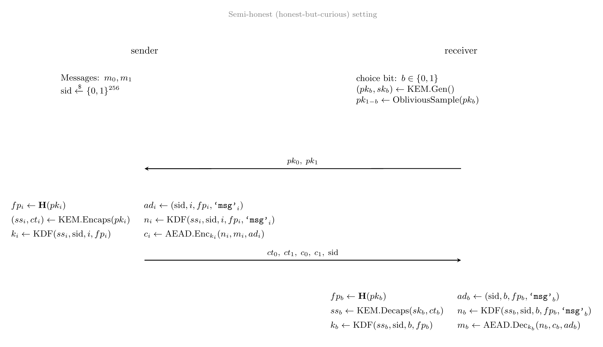
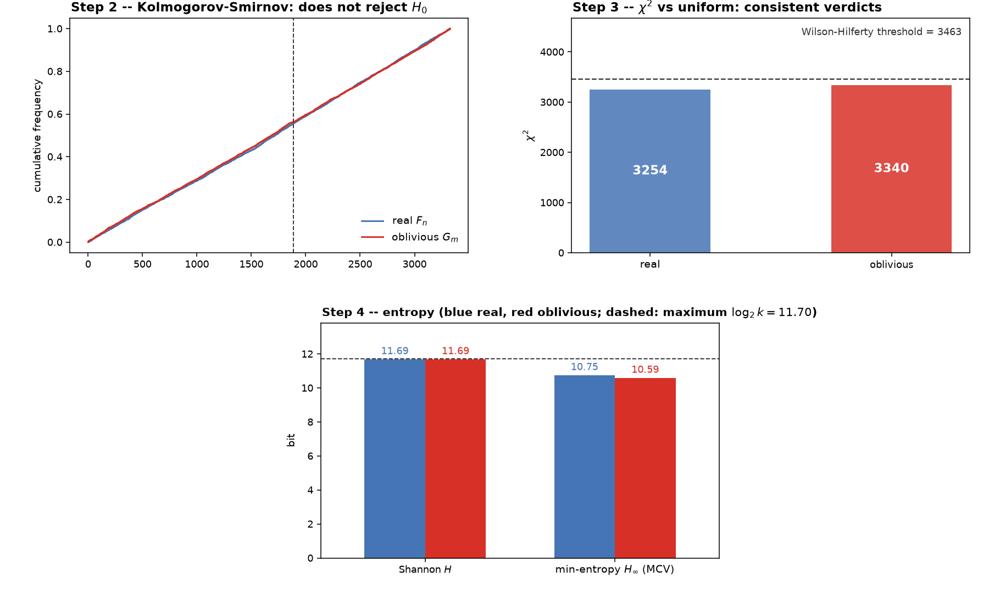
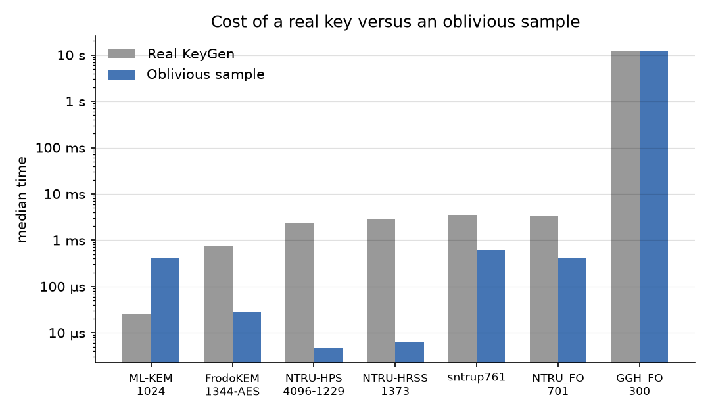
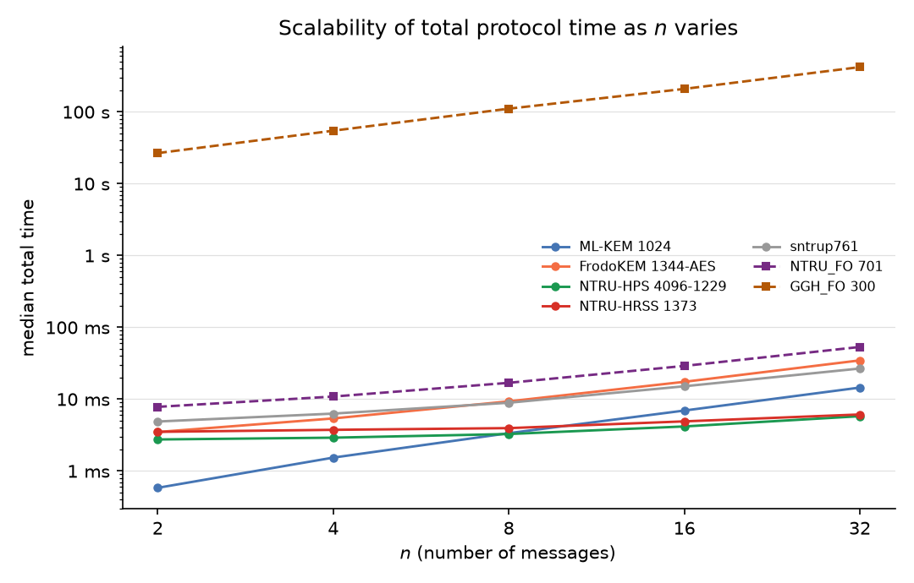
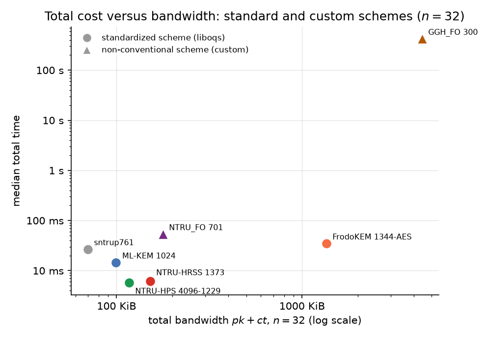

# Project Overview
This project was developed as part of a 2-year master's degree program at the Università degli Studi di Milano (University of Milan), following a 3-year bachelor's. It provides a modular implementation of a semi-honest 1-out-of-*n* Oblivious Transfer (OT) built on Key Encapsulation Mechanisms (KEMs), together with an empirical analysis of how well the construction adapts to different post-quantum lattice families. Building on the oblivious public-key technique [1]-[5], the work proposes a new KEM-agnostic 1-out-of-*n* OT scheme in which sampling an oblivious key is the only KEM-specific step, injected as a callable. The scheme is validated across heterogeneous KEMs (structured, unstructured, NTRU-based and GGH-based), measuring indistinguishability, cost and bandwidth as the number of branches grows.

## Attribution
Oblivious public-key sampling is **not** a contribution of this work. Having the receiver publish a key for which it knows no secret key goes back to Even, Goldreich and Lempel [1] and Bellare and Micali [2]. Naor and Pinkas [3] use it to build OT from public-key encryption, Peikert, Vaikuntanathan and Waters [4] generalize it with dual-mode cryptosystems, and Masny and Rindal [5] formalize it for any two-message KEM, with post-quantum instantiations. Gertner et al. [6] show that some such non-black-box property is unavoidable: no OT reduces black-box to a KEM or an IND-CPA PKE. What this work adds is the generalization to *n* branches, concrete samplers for several lattice families (ML-KEM, FrodoKEM, NTRU-HPS/HRSS, sntrup761, NTRU_FO, GGH-HNF) and an empirical validation of the construction.

# modularot Python Package
The package itself (source code, `pyproject.toml`, installation and usage instructions) lives in the [release branch](https://github.com/TheGaBr0/modularot/tree/release). This branch holds the thesis material built around it.

## The OT scheme
Receiver and sender run the KEM-based 1-out-of-2 protocol below (the *n*-branch version repeats the sender step for every public key). The receiver keeps a real keypair only for its choice bit and fills the other slot with an oblivious public key; the sender encapsulates under both keys and seals each message with an AEAD whose key, nonce and associated data are derived from the shared secret, the session id and the key fingerprint.



# Experimental results
The figures come from the verification suite and the scaling benchmark of the package. They are the thesis figures with English labels (data unchanged).

## Indistinguishability of real and oblivious public keys
Receiver privacy requires that an oblivious public key cannot be told apart from a real one. For each KEM, the samplers were tested with a Kolmogorov-Smirnov test on the empirical distribution of coefficients (step 2), a χ² test against the uniform distribution (step 3) and entropy estimates (step 4). Example for ML-KEM-768: the two empirical CDFs overlap, both χ² values stay below the threshold, and Shannon entropy is 11.69 bits for both.



## Component reuse (mix and match)
Attempts to reuse components outside the triple (session id, branch, public key) are rejected. Example for ML-KEM-768:


## Cost of sampling
Median time of a real key generation against an oblivious sample, for the most secure instance of each family. The sampler/KeyGen ratio depends on the family: the samplers are pure Python, so they are slower than liboqs's C KeyGen for ML-KEM, while KeyGen dominates for FrodoKEM and NTRU.



## Scalability in n
Median total protocol time as the number of branches *n* grows (log scale). Cost grows roughly linearly with *n* for every KEM; GGH_FO is about four orders of magnitude slower than the others.



## Standard vs custom schemes
Total time against total bandwidth at *n* = 32, standardized schemes against custom ones (NTRU_FO, GGH_FO).



# More figures
The remaining figures are in [`figures/`](figures):
- Indistinguishability tests: [FrodoKEM-640-AES](figures/indistinguishability_frodokem.png), [NTRU-HPS-2048-509](figures/indistinguishability_ntru-hps.png), [NTRU-HRSS-701](figures/indistinguishability_ntru-hrss.png), [sntrup761](figures/indistinguishability_sntrup761.png), [NTRU_FO-701](figures/indistinguishability_ntrufo.png), [GGH_FO-100](figures/indistinguishability_gghfo.png)
- Component reuse: [GGH_FO](figures/component_reuse_gghfo.png)
- Protocol cost: [time per phase at n = 32](figures/time_per_phase.png), [bandwidth at n = 32](figures/bandwidth.png)

# Reproducing the results
Everything under [`tests/`](tests) regenerates the graphs and CSVs above. It needs the package from the [release branch](https://github.com/TheGaBr0/modularot/tree/release) installed with the `custom-kems` extra, plus `matplotlib`.
```
python tests/run_all.py --quick     # smoke test, a few minutes
python tests/run_all.py             # full run, slow because of GGH_FO at dimension 300
```
Outputs go to `tests/output/`:
- `ot_scaling.csv`: scaling benchmark written by `modularot bench`.
- `indistinguishability_*.png/json`, `component_reuse_*.png/json`: [`sampler_indistinguishability.py`](tests/sampler_indistinguishability.py) and [`component_reuse.py`](tests/component_reuse.py).
- `sampling_cost.png`, `time_per_phase.png`, `scalability.png`, `bandwidth.png`, `standard_vs_custom.png`: [`comparison_plots.py`](tests/comparison_plots.py), which reads the benchmark CSV (default: [`tests/data/`](tests/data)).

[`tests/data/`](tests/data) holds two earlier benchmark runs (`ot_scaling_full.csv`, `ot_scaling_ggh.csv`) on smaller instances than the figures above (for example NTRU-HPS-2048-509 and GGH_FO-200 instead of NTRU-HPS-4096-1229 and GGH_FO-300), so plots drawn from them show the same trends with different absolute numbers. Sampler tests use random keys, so their statistics vary slightly between runs; the component-reuse figure is deterministic.

# References
This thesis is sadly written in Italian only. For non-Italian speakers interested in reading the details, please use a translation tool to access the content. 

References can be found at the end of **thesis.pdf** file.
