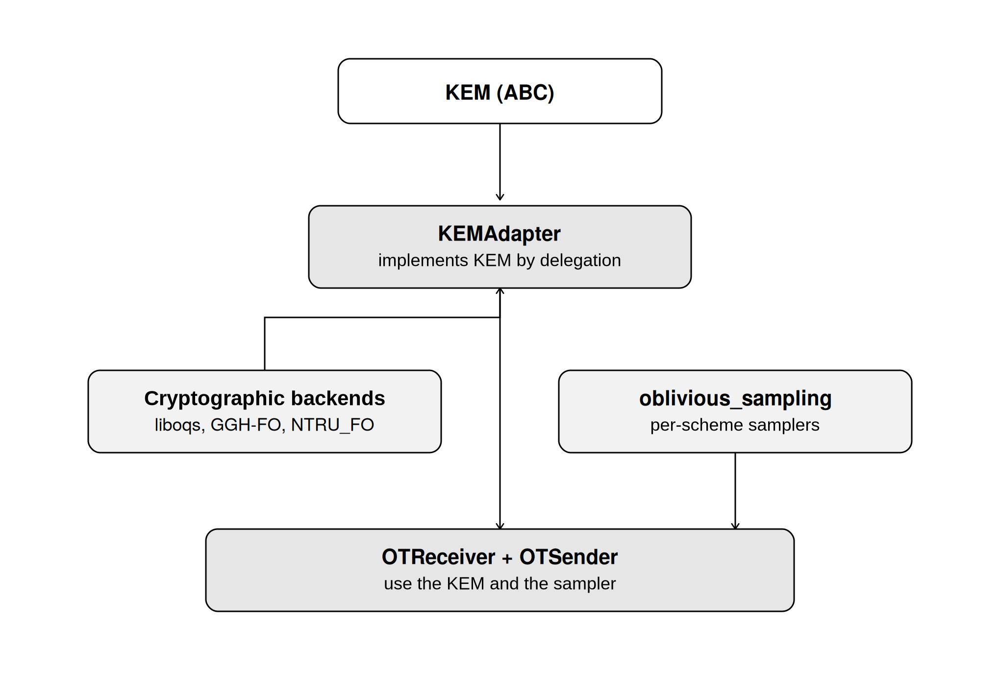

# modularot
The OT protocol never names a specific scheme. The only KEM-specific operation, sampling an *oblivious* public key (a well-formed key whose secret nobody holds), is injected as a callable. This is necessarily KEM-specific: a black-box KEM cannot yield a sender-private OT.

How it works:
1. The receiver generates a real keypair for the chosen branch and an oblivious public key for every other branch, then sends all *n* public keys.
2. The sender encapsulates under each key and seals message *i* with ChaCha20-Poly1305, keyed from the shared secret via HKDF.
3. The receiver decapsulates only the chosen branch. It holds no secret for the others, so those messages stay hidden.

## Architecture


The package is composed of:
- `ot_protocol.py` which implements `OTSender`, `OTReceiver` and `run_ot`, plus an adversarial check that a curious receiver cannot open any other branch.
- `oblivious_sampling.py` which contains the per-family oblivious samplers: ML-KEM / Kyber, FrodoKEM, NTRU-HPS / HRSS, sntrup761, and the custom NTRU_FO and GGH-HNF.
- `kem_adapter/` which defines the `KEM` interface and `KEMAdapter`, used to plug in any KEM.
- `custom_kems/` which contains two research-grade KEMs built from scratch with the Fujisaki-Okamoto transform: `NTRU_FO` and `GGH_FO`.
- `cli.py` which provides the `modularot` command (`run`, `bench`, `list-kems`).

GGH is supported in its HNF form (Micciancio's variant, via [GGH_crypto](https://github.com/TheGaBr0/GGH) with `GGH_private=True`) because it is the only GGH format whose public key admits a sound oblivious sampler. The classic `B = U·R` public basis is distinguishable from any trapdoor-free sample by its determinant alone.

# Installation
```
pip install .
```
This installs `cryptography` and `liboqs-python`. **liboqs-python needs the [liboqs](https://github.com/open-quantum-safe/liboqs) C library built and installed first**; it is not a plain PyPI wheel. Follow the liboqs build instructions, then install `liboqs-python` from PyPI or from a local checkout.

The custom KEMs (NTRU_FO, GGH_FO) are an optional extra with their own native dependency (`python-flint`, built on FLINT/GMP/MPFR):
```
pip install ".[custom-kems]"
```

# General Usage
As a library:
```python
from modularot import run_ot, oqs_kem_factory, resolve_oqs

result = run_ot(
    make_kem=oqs_kem_factory("ML-KEM-768"),
    sampler=resolve_oqs("ML-KEM-768"),
    label="ML-KEM-768",
    choice=1,   # branch the receiver wants
    n=4,        # 1-out-of-4
)
assert result["ok"]      # receiver got the message it asked for
assert result["secure"]  # receiver could not open any other branch
```
`OTSender`, `OTReceiver` and `KEMAdapter` are also exported: to support a KEM that is not in liboqs you only need to write its oblivious sampler (see `oblivious_sampling.py` for worked examples of distinct encodings).

As a program:
```
modularot run                                  # ML-KEM-768, 1-out-of-2
modularot run --n 3 --choice 1 --message "a" --message "b" --message "c"
modularot list-kems                            # names usable with --kem / --kems

modularot bench                                # default KEM subset + custom KEMs
modularot bench --kems ML-KEM-768 sntrup761 --no-custom
modularot bench --ns 2 4 8 16 32 --reps 5 --csv out.csv
```
`run` performs one real transfer. `bench` reports per-phase timing and bandwidth for each KEM across branch counts and writes a CSV.

# Scope and limits
Semi-honest security only. `resolve_oqs` raises `NotImplementedError` for lattice mechanisms whose encoding is not wired yet (e.g. `ntrulpr`). `is_supported_oqs(alg)` checks in advance. NTRU_FO and GGH_FO are educational/research code and are **not** quantum-safe or production-ready.
