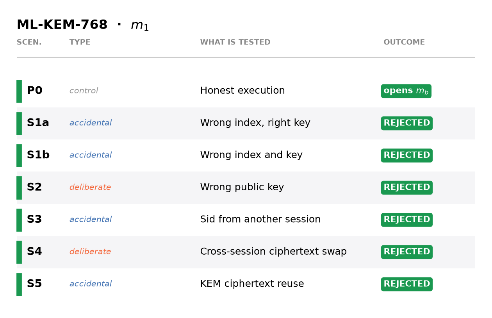

# Project Overview
This project was developed as part of a 2-year master's degree program at the Università degli Studi di Milano (University of Milan), following a 3-year bachelor's. It provides a modular implementation of a semi-honest 1-out-of-*n* Oblivious Transfer (OT) built on Key Encapsulation Mechanisms (KEMs), together with an empirical analysis of how well the construction adapts to different post-quantum lattice families. The work does not claim a new protocol: it validates the modularity of the construction across heterogeneous KEMs (structured, unstructured, NTRU-based and GGH-based), measuring cost and bandwidth as the number of branches grows.

# modularot Python Package
The package itself (source code, `pyproject.toml`, installation and usage instructions) lives in the [release branch](https://github.com/TheGaBr0/modularot/tree/release). This branch holds the thesis material built around it.

# Experimental results
The figures come from the verification suite and the scaling benchmark of the package. They are the thesis figures with English labels (data unchanged).

## Indistinguishability of real and oblivious public keys
Receiver privacy requires that an oblivious public key cannot be told apart from a real one. For each KEM, the samplers were tested with a Kolmogorov-Smirnov test on the empirical distribution of coefficients (step 2), a χ² test against the uniform distribution (step 3) and entropy estimates (step 4). Example for ML-KEM-768: the two empirical CDFs overlap, both χ² values stay below the threshold, and Shannon entropy is 11.69 bits for both.

## Component reuse (mix and match)
Attempts to reuse components outside the triple (session id, branch, public key) are rejected. Example for ML-KEM-768:

## Cost of sampling
Median time of a real key generation against an oblivious sample, for the most secure instance of each family. The sampler/KeyGen ratio depends on the family: the samplers are pure Python, so they are slower than liboqs's C KeyGen for ML-KEM, while KeyGen dominates for FrodoKEM and NTRU.

## Scalability in n
Median total protocol time as the number of branches *n* grows (log scale). Cost grows roughly linearly with *n* for every KEM; GGH_FO is about four orders of magnitude slower than the others.

## Standard vs custom schemes
Total time against total bandwidth at *n* = 32, standardized schemes against custom ones (NTRU_FO, GGH_FO).

# More figures
The remaining figures are in [`figures/`](figures):
- Indistinguishability tests: [FrodoKEM-640-AES](figures/ind_frodokem.png), [NTRU-HPS-2048-509](figures/ind_ntru-hps.png), [NTRU-HRSS-701](figures/ind_ntru-hrss.png), [sntrup761](figures/ind_sntrup761.png), [NTRU_FO-701](figures/ind_ntrufo.png), [GGH_FO-100](figures/ind_gghfo.png)
- Component reuse: [GGH_FO](figures/mix_and_match_gghfo.png)
- Protocol cost: [time per phase at n = 32](figures/cap7_tempi_per_fase.png), [bandwidth at n = 32](figures/cap7_occupazione_banda.png)

# References and final notes
The thesis is written in Italian.
